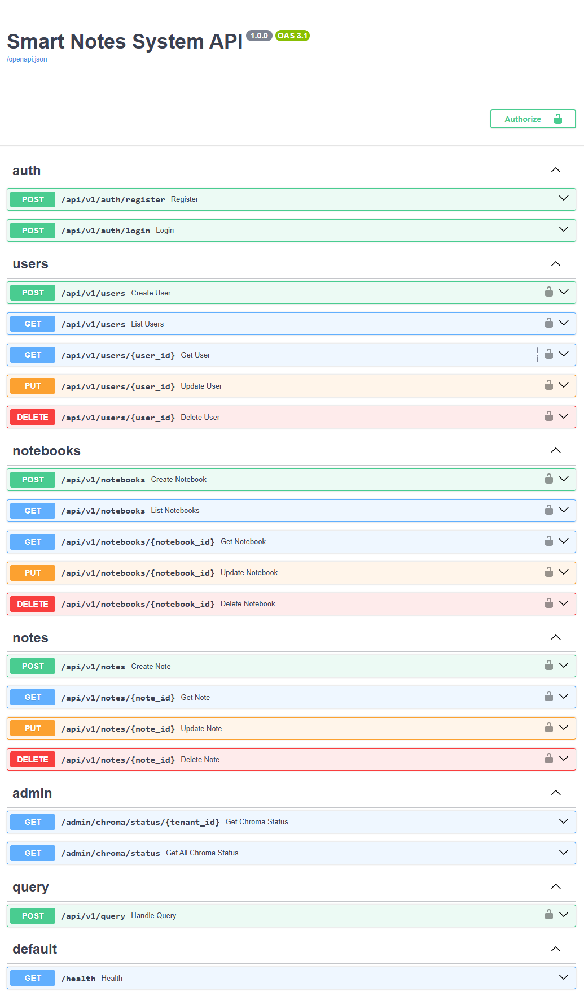
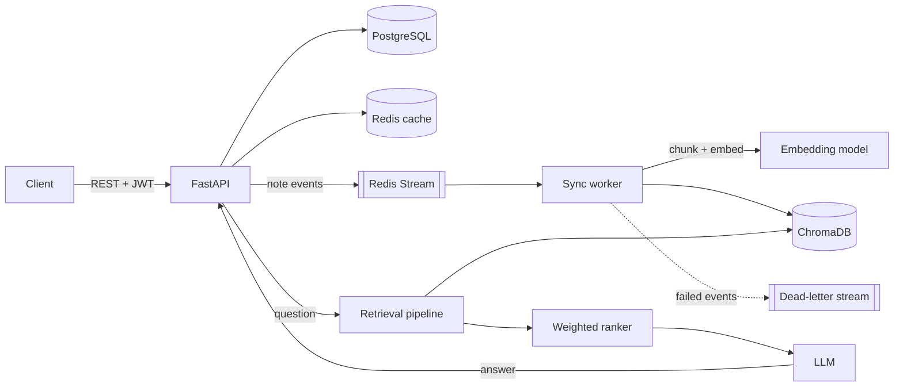

# NoteMind

**Ask questions about your own notes in plain language.**

NoteMind is the backend of a note-taking application with semantic search. Notes are stored in PostgreSQL, synced in the background into a vector database, and used as context when a user asks a question. Answers come only from the user's own notes, ranked by meaning, freshness and how often a note is used.

<!-- Screenshot or GIF: Swagger UI or an example question and answer -->


---

## Features

- **Question answering over personal notes** using retrieval-augmented generation (RAG)
- **Custom ranking** that combines semantic similarity with recency and access history
- **Event-driven sync:** every note change is published to a Redis Stream and processed by a background worker that updates the embeddings
- **Reliable processing:** retries with exponential backoff and a dead-letter stream for failed events
- **Conversation memory:** recent messages and user intents are kept per session and added to the prompt
- **Multilingual notes:** language detection and sentence-based chunking
- **Caching and rate limiting** with Redis
- **JWT authentication** with role-based access
- **Load and concurrency tests** for the database and cache layers

---

## Architecture
## Performance


**Write path.** When a note is created, updated or deleted, the API saves it in PostgreSQL and emits an event to a Redis Stream. A worker in a consumer group reads the event, splits the note into chunks, creates embeddings and updates ChromaDB. Events that keep failing after several retries are moved to a dead-letter stream instead of blocking the queue.

**Read path.** A question is embedded and matched against the user's notes in ChromaDB. The candidates are re-ranked, the best ones are combined with the recent conversation into a prompt, and the LLM writes an answer based on that context.

The code follows a layered structure: domain entities and value objects in `core/entities`, data access in `core/repositories`, business logic in `core/services`, and external systems (database, cache, vector store) in `infrastructure`.

---

## How retrieval ranking works

Vector similarity alone does not know whether a note is old, pinned or never opened. NoteMind re-ranks the retrieved notes with a weighted score:

```
score = 0.7 · semantic_similarity + 0.2 · recency + 0.1 · last_accessed
```

- **Recency** and **last accessed** decay with a half-life of 30 days: `0.5 ^ (age / 30 days)`
- **Pinned** notes get a small boost (+0.05), **archived** notes a penalty (−0.10)
- All values are clamped to `[0, 1]`, and notes below a configurable similarity threshold are dropped

The weights are a starting point. Tuning them on real usage data is one of the next steps.

---

## Tech stack

| Area | Tools |
|---|---|
| API | Python, FastAPI, Pydantic |
| Database | PostgreSQL, SQLAlchemy, Alembic |
| Cache and messaging | Redis, Redis Streams |
| Vector search | ChromaDB |
| AI | OpenAI embeddings and chat models, NLTK, tiktoken, langdetect |
| Auth | JWT |
| Infrastructure | Docker, Docker Compose |
| Testing | pytest |

---

## Quick start

**Requirements:** Docker and Docker Compose, and an OpenAI API key.

```bash
git clone https://github.com/Ebrahim2029/notemind.git
cd notemind
cp .env.example .env        # then set OPENAI_API_KEY, passwords and JWT_SECRET
docker compose up -d --build
docker compose exec api alembic upgrade head
```

The API runs on `http://localhost:9000`. Interactive documentation is at `http://localhost:9000/docs`.

### Main endpoints

| Method | Endpoint | Description |
|---|---|---|
| POST | `/api/v1/auth/register` | Create an account |
| POST | `/api/v1/auth/login` | Get an access token |
| CRUD | `/api/v1/notebooks` | Manage notebooks |
| CRUD | `/api/v1/notes` | Manage notes |
| POST | `/api/v1/query` | Ask a question about your notes |
| GET | `/health` | Health check |

---

## Testing

```bash
pip install -r requirements.txt pytest
pytest                          # full suite (needs PostgreSQL and Redis running)
pytest tests/test_ai tests/test_entities tests/test_services tests/test_retries.py   # unit tests only
pytest tests/perf               # concurrency tests
```

The concurrency test starts several threads at the same moment, each running create, read, filter and delete operations on the repositories, and checks that the average latency stays under 100 ms.

---

## Roadmap

- Hybrid search that combines keyword (BM25) and vector results
- Learning the ranking weights from user feedback instead of fixing them by hand
- Support for local open-source embedding models
- A web client

---

## License

MIT. See [LICENSE](LICENSE).
