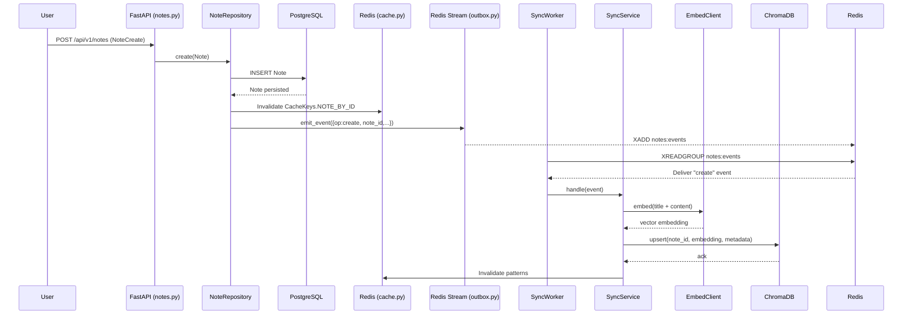

### 🔎 Flow Walkthrough (Create Note)

1. **Client → FastAPI (notes.py)**
   User calls `POST /api/v1/notes` with note data.

2. **FastAPI → NoteRepository (note\_repository.py)**
   `create_note()` builds a `Note` entity → calls `NoteRepository.create()`.

3. **NoteRepository → Database (PostgreSQL)**
   Persists the note inside a transaction.
   Then invalidates cache and **emits event** (`op=create`) via `emit_event()`.

4. **NoteRepository → Outbox (outbox.py)**
   `emit_event()` publishes the event to **Redis Stream (`notes:events`)**.

5. **Sync Worker (sync\_worker.py)**
   Separate worker process reads `notes:events` from Redis Stream.
   Calls `SyncService.handle(event)`.

6. **SyncService (sync\_service.py)**

   * If `op=create`: generates embedding with `embed_client`.
   * Calls `ChromaClient.upsert()` to store vector in Chroma.
   * Invalidates related Redis cache patterns.

7. **ChromaClient (chroma\_client.py)**
   Sends HTTP request to ChromaDB to upsert note vector.

---

### 📊 Sequence Diagram (Mermaid)

---

