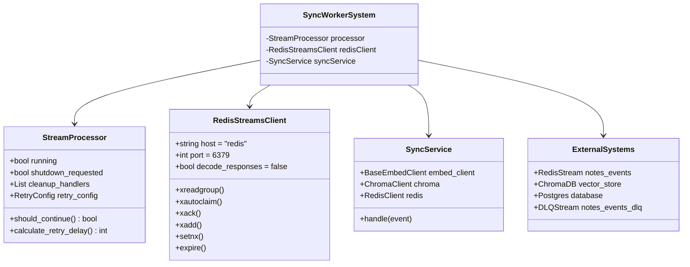
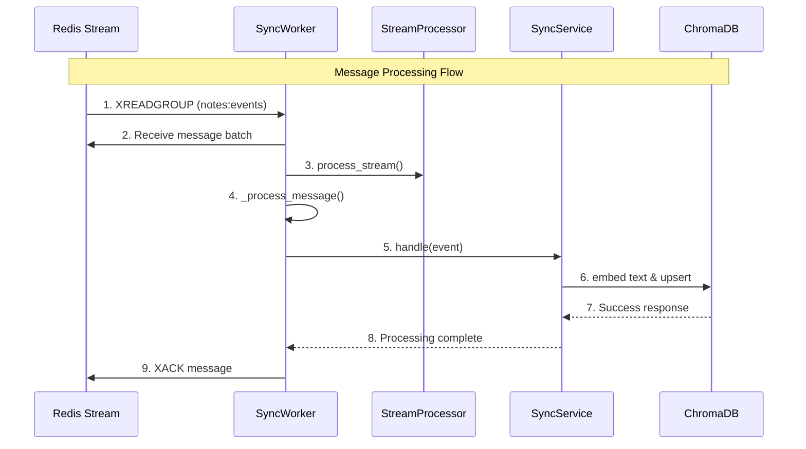
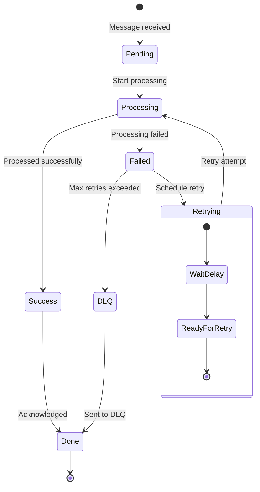
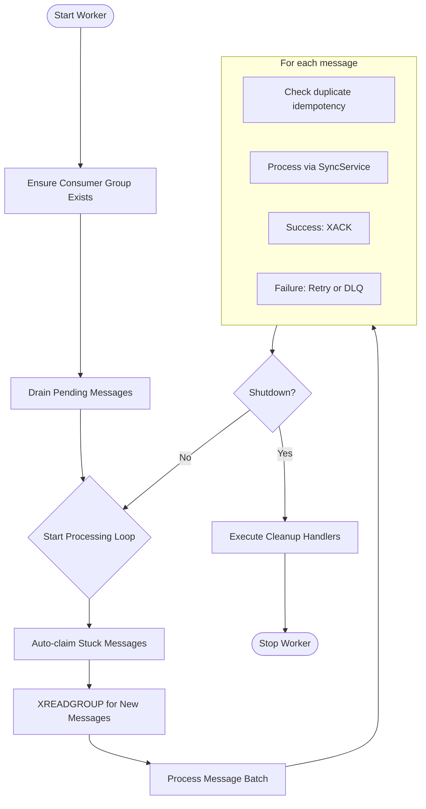
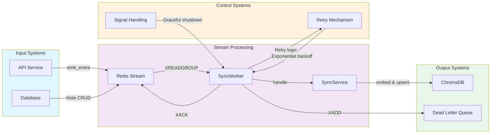
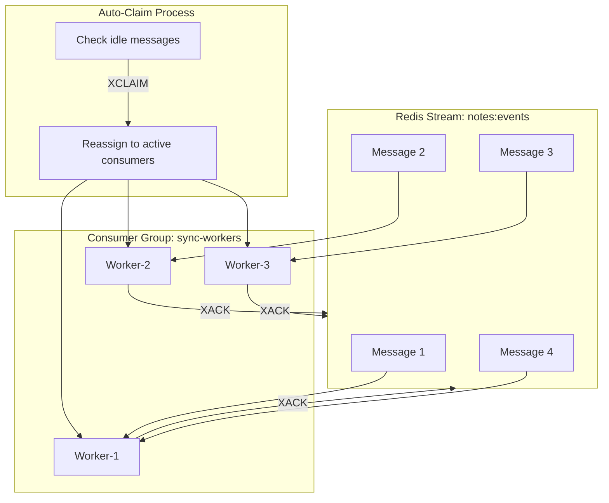

Based on your Redis Streams worker implementation, here are the **Composite Structure Diagram** and **Behavior Diagrams**:

# Composite Structure Diagram

```
┌─────────────────────────────────────────────────────────────────────────────┐
│                             SyncWorker System                                │
├─────────────────────────────────────────────────────────────────────────────┤
│                                                                             │
│  ┌─────────────────┐    ┌─────────────────────────────────────────────┐     │
│  │  StreamProcessor │    │              RedisStreamsClient             │     │
│  │                 │    │                                             │     │
│  │ - running: bool │    │ - host: str = "redis"                       │     │
│  │ - shutdown_req: │    │ - port: int = 6379                          │     │
│  │   bool          │    │ - decode_responses: bool = False            │     │
│  │ - cleanup_hand- │    │ - socket_timeout: int = 5                   │     │
│  │   lers: List    │    │                                             │     │
│  │ - retry_config: │    │ + xreadgroup()                              │     │
│  │   RetryConfig   │    │ + xautoclaim()                              │     │
│  │                 │    │ + xack()                                    │     │
│  │ + should_conti- │    │ + xadd()                                    │     │
│  │   nue() → bool  │    │ + setnx()                                   │     │
│  │ + calculate_re- │    │ + expire()                                  │     │
│  │   try_delay()   │    │                                             │     │
│  └─────────────────┘    └─────────────────────────────────────────────┘     │
│          ▲                         ▲                                        │
│          │                         │                                        │
│          │                         │                                        │
│  ┌───────┴─────────────────────────┴────────┐    ┌─────────────────────┐    │
│  │             SyncWorker                   │    │     SyncService      │    │
│  │                                          │    │                     │    │
│  │ - retry_config: RetryConfig              │    │ - embed_client:      │    │
│  │ - processor: StreamProcessor             │    │   BaseEmbedClient    │    │
│  │ - svc: SyncService                       │    │ - chroma: Chroma-    │    │
│  │                                          │    │   Client             │    │
│  │ + ensure_group()                         │    │ - redis: RedisClient │    │
│  │ + drain_pending()                        │    │                     │    │
│  │ + process_stream()                       │    │ + handle(event)      │    │
│  │ + _process_with_retry() → bool           │    └─────────────────────┘    │
│  │ + _process_message() → ProcessingResult  │              ▲                │
│  │ + _handle_dlq()                          │              │                │
│  └──────────────────────────────────────────┘              │                │
│                             ▲                              │                │
│                             │                              │                │
│                             │                              │                │
│  ┌──────────────────────────┴──────────────────────────────┴──────────────┐ │
│  │                         External Systems                               │ │
│  │                                                                        │ │
│  │  ┌─────────────┐    ┌─────────────┐    ┌─────────────┐    ┌─────────┐  │ │
│  │  │  Redis      │    │  ChromaDB   │    │  Postgres   │    │  DLQ    │  │ │
│  │  │  Stream     │    │  Vector     │    │  Database   │    │ Stream  │  │ │
│  │  │ "notes:events"│  │  Store      │    │             │    │"notes:  │  │ │
│  │  │             │    │             │    │             │    │events:dlq"│  │ │
│  │  └─────────────┘    └─────────────┘    └─────────────┘    └─────────┘  │ │
│  └────────────────────────────────────────────────────────────────────────┘ │
└─────────────────────────────────────────────────────────────────────────────┘
```

# Behavior Diagrams

## 1. Sequence Diagram - Message Processing Flow

```
┌─────────┐    ┌─────────────┐    ┌─────────────┐    ┌─────────────┐    ┌─────────┐
│  Redis  │    │ SyncWorker  │    │StreamProcessor│   │SyncService  │    │ Chroma  │
│ Stream  │    │             │    │              │   │             │    │         │
└────┬────┘    └──────┬──────┘    └──────┬───────┘   └──────┬──────┘    └────┬────┘
     │                 │                  │                  │                │
     │ 1. XREADGROUP   │                  │                  │                │
     │────────────────>│                  │                  │                │
     │                 │                  │                  │                │
     │ 2. Message      │                  │                  │                │
     │<────────────────│                  │                  │                │
     │                 │                  │                  │                │
     │                 │3. process_stream()│                  │                │
     │                 │─────────────────>│                  │                │
     │                 │                  │                  │                │
     │                 │4. _process_message()                 │                │
     │                 │────────────────────────────────────>│                │
     │                 │                  │                  │                │
     │                 │                  │                  │5. handle(event) │
     │                 │                  │                  │───────────────>│
     │                 │                  │                  │                │
     │                 │                  │                  │6. embed text   │
     │                 │                  │                  │───────────────>│
     │                 │                  │                  │                │
     │                 │                  │                  │7. upsert to Chroma
     │                 │                  │                  │───────────────>│
     │                 │                  │                  │                │
     │                 │                  │                  │8. Success      │
     │                 │                  │                  │<───────────────│
     │                 │                  │                  │                │
     │                 │9. XACK           │                  │                │
     │<────────────────│                  │                  │                │
     │                 │                  │                  │                │
```

## 2. State Machine Diagram - Message Lifecycle

```
┌─────────────────────────────────────────────────────────────────────────────┐
│                           Message Lifecycle                                 │
├─────────────────────────────────────────────────────────────────────────────┤
│                                                                             │
│  ┌─────────────┐      ┌─────────────┐      ┌─────────────┐      ┌─────────┐ │
│  │   Pending   │─────>│ Processing  │─────>│  Success    │─────>│  Done   │ │
│  │ (Unacked)   │      │             │      │             │      │ (Acked) │ │
│  └─────────────┘      └─────────────┘      └─────────────┘      └─────────┘ │
│        │                     │                     │                        │
│        │                     │                     │                        │
│        ▼                     ▼                     ▼                        │
│  ┌─────────────┐      ┌─────────────┐      ┌─────────────┐                  │
│  │   Failed    │─────>│  Retrying   │      │   DLQ       │                  │
│  │ (Unacked)   │      │             │      │ (Acked)     │                  │
│  └─────────────┘      └─────────────┘      └─────────────┘                  │
│        ︎                     │                     │                        │
│        ︎                     ▼                     │                        │
│        ︎             ┌─────────────┐               │                        │
│        ︎             │ Max Retries │───────────────┘                        │
│        ︎             │ Exceeded    │                                       │
│        ︎             └─────────────┘                                       │
│        ︎                                                                    │
└─────────────────────────────────────────────────────────────────────────────┘
```

## 3. Activity Diagram - Stream Processing Workflow

```
┌─────────────────────────────────────────────────────────────────────────────┐
│                        Stream Processing Workflow                           │
├─────────────────────────────────────────────────────────────────────────────┤
│                                                                             │
│  [Start Worker]                                                             │
│        │                                                                    │
│        ▼                                                                    │
│  [Ensure Consumer Group Exists]                                             │
│        │                                                                    │
│        ▼                                                                    │
│  [Drain Pending Messages]                                                   │
│        │                                                                    │
│        ▼                                                                    │
│  ┌─────────────────┐                                                        │
│  │ For each batch: │                                                        │
│  └─────────────────┘                                                        │
│        │                                                                    │
│        ▼                                                                    │
│  [Auto-claim Stuck Messages]                                                │
│        │                                                                    │
│        ▼                                                                    │
│  [XREADGROUP for New Messages]                                              │
│        │                                                                    │
│        ▼                                                                    │
│  ┌─────────────────────────────────────────────────────────────────────┐   │
│  │ For each message:                                                   │   │
│  │   1. Check duplicate (idempotency)                                  │   │
│  │   2. Process message via SyncService                                │   │
│  │   3. If success → XACK                                              │   │
│  │   4. If failure → retry or send to DLQ                              │   │
│  └─────────────────────────────────────────────────────────────────────┘   │
│        │                                                                    │
│        ▼                                                                    │
│  [Shutdown?] ───Yes───→ [Execute Cleanup] ───→ [Stop]                       │
│        │No                                                                  │
│        ▼                                                                    │
│  [Continue Loop]                                                            │
│                                                                             │
└─────────────────────────────────────────────────────────────────────────────┘
```

## 4. Component Interaction Overview

```
┌───────────────────────┐    ┌───────────────────────┐    ┌───────────────────────┐
│      API Service      │    │     Redis Stream      │    │     SyncWorker        │
│                       │    │                       │    │                       │
│  ┌─────────────────┐  │    │  ┌─────────────────┐  │    │  ┌─────────────────┐  │
│  │   emit_event()  │──┼────┼─>│  XADD to stream │  │    │  │ XREADGROUP      │  │
│  └─────────────────┘  │    │  └─────────────────┘  │    │  │ processing      │  │
│                       │    │                       │    │  └─────────────────┘  │
└───────────────────────┘    └───────────────────────┘    │           │           │
                                                          │           ▼           │
┌───────────────────────┐    ┌───────────────────────┐    │  ┌─────────────────┐  │
│      Database         │    │      ChromaDB         │    │  │  SyncService    │──┼─┐
│                       │    │                       │    │  │                 │  │ │
│  ┌─────────────────┐  │    │  ┌─────────────────┐  │    │  │  handle(event)  │──┼─┼─>┐
│  │   Note CRUD     │  │    │  │   Vector        │<─┼────┼──│                 │  │ │  │
│  └─────────────────┘  │    │  │   Operations    │  │    │  └─────────────────┘  │ │  │
│                       │    │  └─────────────────┘  │    │                       │ │  │
└───────────────────────┘    └───────────────────────┘    └───────────────────────┘ │  │
                                                                                    │  │
┌───────────────────────┐    ┌───────────────────────┐                              │  │
│      Dead Letter      │    │     Retry Mechanism   │                              │  │
│         Queue         │    │                       │                              │  │
│                       │    │  ┌─────────────────┐  │                              │  │
│  ┌─────────────────┐  │    │  │  Exponential   │  │                              │  │
│  │   XADD to DLQ   │<─┼────┼──│   Backoff      │<─┼──────────────────────────────┘  │
│  └─────────────────┘  │    │  └─────────────────┘  │                                │
│                       │    │                       │                                │
└───────────────────────┘    └───────────────────────┘                                │
                                                                                      │
┌───────────────────────┐                                                            │
│     Signal Handling   │                                                            │
│                       │                                                            │
│  ┌─────────────────┐  │                                                            │
│  │  Graceful       │  │                                                            │
│  │  Shutdown       │<─┼────────────────────────────────────────────────────────────┘
│  └─────────────────┘  │
│                       │
└───────────────────────┘
```

## Key Architectural Features:

1. **At-Least-Once Delivery**: XREADGROUP + XACK pattern ensures messages are processed at least once
2. **Idempotency**: Duplicate detection using Redis SETNX
3. **Dead Letter Queue**: Failed messages after max retries go to DLQ
4. **Exponential Backoff**: Smart retry mechanism for transient failures
5. **Graceful Shutdown**: Signal handling for clean termination
6. **Consumer Group**: Multiple workers can load balance
7. **Auto-Claim**: Stuck messages are automatically reclaimed from other consumers

This architecture provides production-grade reliability for your stream processing system!

---

Here are the **Mermaid.js diagrams** for your Redis Streams worker system:

## 1. Composite Structure Diagram



## 2. Sequence Diagram - Message Processing



## 3. State Machine Diagram - Message Lifecycle



## 4. Activity Diagram - Stream Processing Workflow



## 5. Component Interaction Diagram



## 6. Consumer Group Architecture



These Mermaid diagrams visualize:

1. **Composite Structure**: The main components and their relationships
2. **Sequence Flow**: How messages are processed from Redis to ChromaDB
3. **State Machine**: The lifecycle of a message through the system
4. **Activity Workflow**: The overall processing loop with error handling
5. **Component Interaction**: How different parts of the system work together
6. **Consumer Groups**: How multiple workers load balance messages

You can use these diagrams in your documentation to explain the architecture and behavior of your Redis Streams worker system!